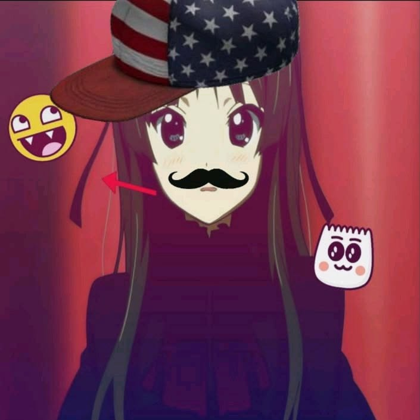

  

  <h1>bnokyo.exe</h1>

  
<code>reverse engineering things I probably shouldn't poke</code>

  
¯\_(ツ)_/¯ &nbsp; powered by Python and questionable ideas

---

## `> whoami`

Just a developer who likes figuring out what makes software tick.

- `>>` Taking programs apart to understand how they work.
- `>>` Python is my go-to for scripts, experiments, and random projects.
- `>>` I build stuff, break it, fix it, and somehow repeat the process.
- `>>` Most of my repositories are private. The secret lab remains classified. :]

currently running on caffeine.exe (not guaranteed to work)

## `> activity.log`

  
   
  

## `> tools.exe`

  made with code, curiosity, and probably a few bugs
   
  <code>exit(0); // see ya :]</code>

